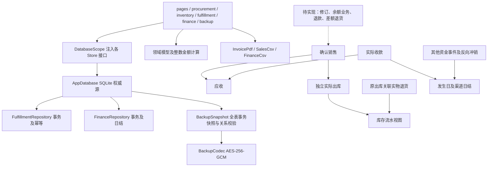
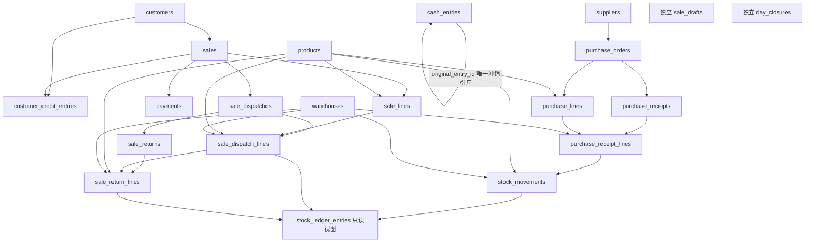

# 正式版收口：实现核查与实施门禁（2026-11-07）

本文件记录首次核查基线，保留当时缺口以供追溯。当前改单/v8及余额/v9的实现与规则见 [第二阶段交付记录](phase2-sales-revision.md) 和 [第三阶段交付记录](phase3-customer-credit.md)，当前发布判定见根目录验收报告。

本轮范围以用户的正式版闭环要求为准，取代旧文档的 MVP 范围限制。检查基线 HEAD 为 `2cd879abc8634800c55cca26658c3b9b1bb1e4a8`，但含大量任务前未提交修改，不能把结果归属为该提交的验证。未修改或清理这些原有修改。

## 真实实现与缺口

| 功能 | 可核查代码 | 当前判断 / 后续影响 |
|---|---|---|
| 开单、查询、补收款、欠款 | `SalesStore`、`AppDatabase.createSale/addPayment/_loadSales/customerOutstanding`，`pages.dart` | 已有实现及自动化；真机仍 NOT RUN。原始已确认单不可编辑 |
| 金额、草稿 | `money.dart`、`SaleEditorPage`、`sale_drafts` | 整型分、毫米、逐行取整；事务创建销售并删除草稿 |
| 独立出库、实物退货 | `FulfillmentRepository`、`fulfillment_pages.dart`、`FulfillmentSchema` | 引用真实销售行与原出库，库存视图求和；不改收款及应收 |
| 单据修订、历史版本 | `SalesStore` 无相关命令；`Sale` 无版本字段 | 未实现。必须扩展领域、应用接口、数据库事务、UI、履约读取、备份、输出 |
| 客户余额 | `CustomerCreditLedger`、v7迁移、`SaleSettlement` | 仅底层流水/纯计算原型；没有正式来源凭证、销售抵扣、余额页面；欠款查询未计余额。不能宣称闭环 |
| 退款 | `payments` 仅正收款；`FinanceRepository._statement` 仅读收款与其他收支 | 无待退款/实际退款表和接口；不得用其他费用模拟销售退款 |
| 改单退货 | 原出库关联退货已实现 | 缺修订差额待办与版本关联；不能以减价视为入库 |
| 输出 | `InvoicePdf`、`SalesCsvExporter`、`finance_csv.dart` | 已有 PDF/图像/CSV；`Sale` 没有版本/抵扣/退款字段，输出未覆盖这些正式版内容；物理打印 NOT RUN |
| 客户商品 | `CustomersPage`、`ProductsPage`，`Customer/Product` | 仅新增列表；无编辑、停用、搜索。两表无 active；需新增迁移及备份兼容，不可改历史快照 |
| 迁移备份 | `AppDatabase._open`、`BackupSnapshot`、`BackupCodec`、`BackupPage` | schema v7，备份支持 v2–v7；全空库原子恢复；修订退款模型尚无可备份数据 |
| 正式交付 | Android Gradle、签名配置、设备测试 | ADB 发现 RMX3093 不等于业务验收；本轮未构建/安装 Release，未升级、未打印 |

## 架构与业务关系

不设置跨页权威余额缓存。UI 从 Store 查询，草稿为 SQLite 持久工作副本。当前 `SaleLine` 不暴露数据库行 ID；修订需先解决稳定行身份，不能通过商品 ID 推断同商品重复行。

## 数据库依赖（箭头为父表到引用表）

`day_closures` 没有资金表外键，由业务日期及快照回放校验关联。`sale_drafts` 不进账。schema 历程：v1销售/收款，v2草稿，v3采购，v4入库库存，v5出库退货及视图，v6其他资金/日结，v7客户余额流水。本轮未新增或重写迁移。

## 已有规则与待确认规则

已确认依据：`prd.md`、`sales-revision-implementation.md` 和事务实现。

- 更换客户后原款仍归原客户，新客户重新付款；原收款不得随 `sales.customer_id` 隐式转移。
- 原单号稳定，历史交易及已出库原行不得删除覆盖。金额减少、实际退款、实物入库为不同事件。
- 实际退货引用原出库行、原仓库与批次；累计不得超出原实际出库。
- 日结现按收款 `created_at` 日期和其他收支 `business_date`、支付渠道统计净变动；关账后拒绝新增当日资金。退款应按实际发生日期/渠道计支出，保留历史日结。
- 金额分、长度毫米；余额由流水累计，不允许页面直接改数。

尚无充分依据，已向用户提出确认：

1. 可编辑字段清单，尤其客户和销售日期；是否允许改变已出库行的商品、门幅，如何匹配原行。
2. 余额是否仅来自应退款转入，是否允许预存或手工调整；现金与余额优先顺序、是否每次改单自动追加抵扣。
3. 同一应退款是否允许拆分现金退款/转余额；原客户款项应生成待退款还是自动转余额。
4. 连续改单时未处理待办重算还是按版本独立保留；已部分退款/退货后金额增回如何处理。
5. 历史版本能否打印及默认版本；版本单据中的收退款展示为当时快照还是当前累计。

`SaleSettlement` 及其测试隐含“更客旧款转余额、现金优先”的原型假设；测试存在不代表用户已确认，暂不接入生产。库存方案需明确累计出库或净出库作为数量上限，以及实际退货后能否重新发货。

## 按依赖实施及验证

| 顺序 | 实现范围 | 通过门禁 |
|---|---|---|
| P0 | 确认规则；追加版本头/版本明细、稳定行身份、修改差额、请求幂等和乐观版本校验；当前有效版统一读取；编辑与历史UI | 未/部分/全收款×未/部分/全出库，增删行与数量价格变化、连续两次、旧版本冲突、重复及失败回滚；每例DB+UI |
| P1 | 收款时客户归属、余额来源凭证和分配关系；余额/明细页、转入及自动抵扣 | 不超抵、不重复、旧款不移客、现金与抵扣守恒；P0+P1集成回归 |
| P2 | 退款义务与实际退款独立凭证、渠道日期日结；修订退货待办引用真实出库 | 部分/重复/超退、退款后再改单、待办与实际退货对齐；退款+退货集成回归 |
| P3 | 扩展PDF/CSV版本结算信息；客户商品编辑/停用/搜索 | 输出文件核对、历史快照不变、停用不可新选；两模块集成回归 |
| P4 | 按最终模型追加迁移和快照校验，兼容旧版 | 全新/升级、迁移失败、加密导出→独立空库恢复→重开逐表核账；不可仅检查行数 |
| P5 | 冻结源码身份，构建签名Release，隔离设备业务验收、外部打印/分享、备份与同签名升级 | 全链路实际金额/数量/余额、进程重启、升级前后核账，证据齐全后决策 |

所有会写入的新业务模型同时实现备份支持后才开放入口。现有备份校验禁止超收，与待退款不兼容；必须在新增快照版本中改为验证资金守恒，不能简单删除上限校验。不得静默修改 v7 已有迁移。

## 本轮新增存储验证

`test/release_storage_test.dart` 使用临时目录，不触碰设备业务库：

- 重建 v6 隔离夹具（去掉 v7 唯一新增表并设 user_version=6），升级后逐表比较销售、收款等数据及欠款；该夹具不是历史设备数据库。
- 非空 v7余额流水加密备份、空库恢复、关闭重开，全表与累计余额比对；流水为人工测试夹具，不宣称已实现真实退款转余额。
- 构造迁移建表冲突，断言升级失败后 user_version=6、销售和收款逐行不变、冲突表原内容保留、完整性正常。失败日志包含预期 SQLite 报错。

正式版功能仍未完成；本文件为可执行计划与已验证基线，不是功能交付通过证明。
