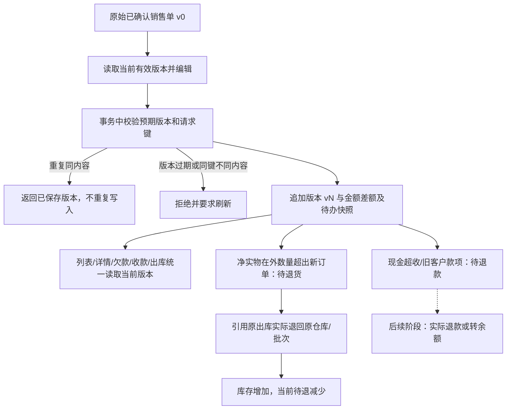
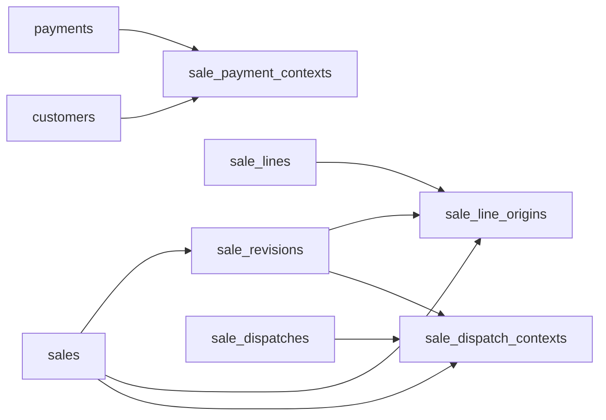

# 第二阶段：已确认销售单修改（2026-11-07）

本文件保留第二阶段交付时状态。当前v9余额业务及再次改单结算已由 [第三阶段](phase3-customer-credit.md) 补齐；下方“余额未交付”等描述仅对应第二阶段当时范围。

本阶段已完成代码及本机自动化集成验证，尚未完成 Android Release 真机验收。正式版整体仍 NO-GO：客户余额业务、实际退款及日结、外围管理和最终设备验收仍未完成。

## 用户已确认的规则

- 允许更换客户、修改销售日期、商品明细、数量、单价、优惠与备注。编号、原创建时间及各历史版本快照不重写。
- 减价超收先形成待退款，不自动退款或转入余额。更换客户后原款仍归原客户，新客户重新付款。
- 已出库行减量或删除形成待退货，实际退回前不增加库存。商品身份或门幅变化建立新行，原已出库行进入待退货。
- 金额变化、待退款、实际退款、实际退货是不同事件。

## 实现与状态

入口：销售详情 → 修改已确认销售单 → 核对前后金额/差额及原客户应退/新客户应收 → 确认保存 → 当前版本详情。保存后展示待退款和待退货，并可进入既有原出库关联退货页面。历史版本详情只读。

原始 `sales` 和既有 `sale_lines` 不更新、不删除。金额/数量调整保存在追加版本中；新商品行或商品型号、规格、门幅替换建立新的物理行ID。原行ID继续被原出库引用，不能按商品ID合并重复行。

当前应收为 `max(当前合同金额 - 当前客户归属段现金收款, 0)`；超收作为待退款显示，不再显示为负欠款。客户 A→B→A 会创建三个归属段，最初 A 的款不会重新抵扣最后 A 的新应收。同一客户改单保留已有客户交易与上期欠款快照；更换客户时新版本记录新客户当时的上期欠款，原版保持不变，避免输出把旧客户欠款加到新客户头上。

连续改单：每个版本保存当时待办快照；当前待退款按最新有效合同与各收款归属段重算，当前待退货按真实累计出库减真实累计退回、再减当前订购数量计算。历史快照不回写。现阶段没有实际退款/转余额入口，尚未执行这些动作后的再次改单场景。

实际出库仍保留原系统的累计出库上限规则：同一物理行的累计已出不得超过当前订购量，退回不自动增加可重发数量。改单不自动出库。修改日期不回写收款发生日期，也不改变已冻结的资金日结。

## v8新增数据

| 表 | 作用与约束 |
|---|---|
| `sale_revisions` | 每单version唯一、request_key唯一；原始v0在首次改单事务中归档，v1起记录请求、完整头/行快照、金额差额、收款及待办快照和发生时间 |
| `sale_line_origins` | 新物理行唯一来源，关联销售及创建它的版本；原始物理行没有此记录 |
| `sale_payment_contexts` | 后续现金收款的客户身份和归属段；旧收款及首款按不可变原销售客户/归属段0解析 |
| `sale_dispatch_contexts` | 改单后实际出库绑定所用有效版本，备份按当时版本重放上限；既有出库按原始版本解析 |

没有修改 v1–v7 迁移。v8只追加四表；新库走相同创建逻辑。版本快照保存 `paymentCutoff`、`dispatchCutoff`、`returnCutoff`，可重放保存当时的收款、应退和实物待办。当前有效数据必须经 Store 读取；直接查询原始sales表得到的是原始交易，而不是改单后的合同。

备份快照 schemaVersion=8，兼容旧v2–v7。恢复前校验连续版本、原始快照、请求与输出明细、金额差额、客户归属、收款守恒、待退款/待退货、物理行来源、出库时版本及日结。恢复仍只允许全空数据库，在事务中完成。

## 历史与输出语义

- 当前列表、详情、应收、后续收款、出库读取最新版本；过期版本的收款请求拒绝。
- 历史详情显示保存该版本时的收款和待办。v0是在首次改单时归档原始合同与当时收款，不宣称还原旧设备开单瞬间的资金状态。
- PDF/图片显示所选版本；分享文件名包含版本。CSV v2附版本及当前客户超收待处理金额。跨客户待退款、余额和实际退款的完整输出仍属后续阶段，不能将当前输出认定为正式版全部打印要求通过。

## 验证矩阵

| 编号 | 前置与操作 | 预期与实际结果 | 数据库/UI证据 | 状态 |
|---|---|---|---|---|
| R01–R09 | 合同20000分，收款0/10000/20000分 × 出库0/6000/10000毫米；减量至5000毫米 | 合同10000分、收款不改；超收最大10000分，待退=max(出库-5000,0)；原资金库存事实不变 | `sale_revision_integration_test.dart` 九组合断言，原始头/收款/出库逐表不变，当前与历史、备份恢复逐表比对 | PASS |
| U01–U09 | 同组合从真实SQLite加载界面，改日期/数量并保存；两组另换商品或门幅 | 保存后版本1；相应旧物理行全量待退，当前商品/门幅为新行；历史0只读 | `sale_revision_widget_test.dart`；界面金额/待办、DB版本/金额/行ID及无关草稿保留断言 | PASS |
| R10 | A收15000分→换B→B收4000分→换回A | 两段旧款分别应退15000/4000分，最后A重新应付10000分；日结收款仍19000分 | 客户欠款、pending退款归属、版本及备份校验断言 | PASS |
| R11 | 增商品/数量/单价，收25000分并按v1出11000毫米，再删原行 | v1合同30800分、v2合同2000分、待退23000分和11000毫米；旧版收款及删行出库请求拒绝 | 当前有效明细、原行关联、出库版本和快照校验断言 | PASS |
| R12 | 出库6000毫米后换门幅，实际退2000毫米，再次改单 | 库存只在实际退回时增加4000000微平方米；历史待退6000、当前及下版待退4000毫米 | 库存余额、原出库退回、版本待办快照和当前待办断言 | PASS |
| R13 | 同键并发4次、旧版本、同键不同内容、触发器中断保存 | 同键只生成一个版本；冲突拒绝；中断不留下新行或版本，重试成功且重开一致 | 全表快照比对、版本序列、DB完整性断言 | PASS |
| U10 | 同商品重复原行、提价增量加行→7080分；再删行换客户→2280分；故障后重试 | UI显示差额、原客应退1000分及新客应收2280分；保存失败保留输入，重试版本2且无重复 | `sale_revision_editor_widget_test.dart`；真实DB+UI及历史序列[2,1,0] | PASS |
| R14 | 日结后减价；不存在商品外键保存 | 日结收款仍20000分，产生待退款10000分；外键失败全表不变 | 日报、日结回放及全表快照断言 | PASS |
| R15 | 篡改收款快照、归属段、事件边界、收款客户 | 恢复前拒绝 | `BackupSnapshot.parse` 拒绝断言 | PASS |
| M01 | 重建v7隔离夹具含旧销售收款，升v8；恢复旧v7备份；改单后AES备份再恢复重启 | 旧款不丢，所有业务表一致，待退款500分、历史2版 | `sale_revision_migration_test.dart` | PASS |
| M02 | v7→v8第三张表冲突 | 升级失败保留版本7和原销售收款，前两张新增表回滚 | sqlite_master、user_version、收款原值断言 | PASS |
| R16 | 原客期初欠300分、新客800分，换客改单 | 原客欠款300分，新版上期快照800分、应收合计10800分，历史快照不改 | 客户查询、版本快照及备份断言 | PASS |
| R17 | 删除新增出库的版本关联或改为未来版本 | 恢复前拒绝，而非按旧原行上限放行 | 出库版本与各版本事件边界重放校验 | PASS |
| A01 | 当前工作树全套自动化与静态检查 | 107项通过，analyze无问题 | `release-evidence/phase2-regression-20261107.log`、`phase2-analyze-20261107.log` | PASS |
| D01 | Android Release设备安装、改单、进程强杀重启、打印及升级 | 未执行；触发器回滚不是设备进程中断 | 无设备操作证据 | NOT RUN |

Release APK构建及签名校验PASS，第二阶段产物已保留为 `build/release-candidates/phase2-0.1.1+2.apk`，SHA-256 `e92423e4de2ba71f1f5766e1a05ef0f76fd62458e9bf3cf5073c572b3a8ae7b1`。构建不是安装/升级验收；包内版本0.1.1+2、标识com.kaibao.kaibao_sales与签名身份校验记录在根目录验收报告。Flutter测试与构建不得在同一工作树并行，避免插件注册生成文件互相影响。

迁移旧库为可恢复的重建夹具，不是历史发行设备数据库副本。SQLite测试使用临时文件，未触碰手机业务库。新增测试之外，既有金额、开单、草稿、收款、采购、出入库、资金日结、备份与输出套件均参加全量回归。没有修改已有业务测试的预期来适配新行为；旧版夹具仅移除新增表，当前版篡改测试保留完整表结构以确保真正测试金额篡改。

## 本阶段限制与后续

实际退款登记、转余额及自动抵扣尚未交付；不支持以负收款或其他费用伪装退款。待退款可查看而不能在本阶段结清。相应部分退款/转余额之后再改单、资金日结与完整退款输出，必须在后续模型落地时补齐并执行跨模块回归。

真机中文输入、设备异常退出、物理打印、接收端分享、离机恢复和同签名升级仍 NOT RUN。不能依据本机107项测试或Release构建成功宣称正式版可发布。
