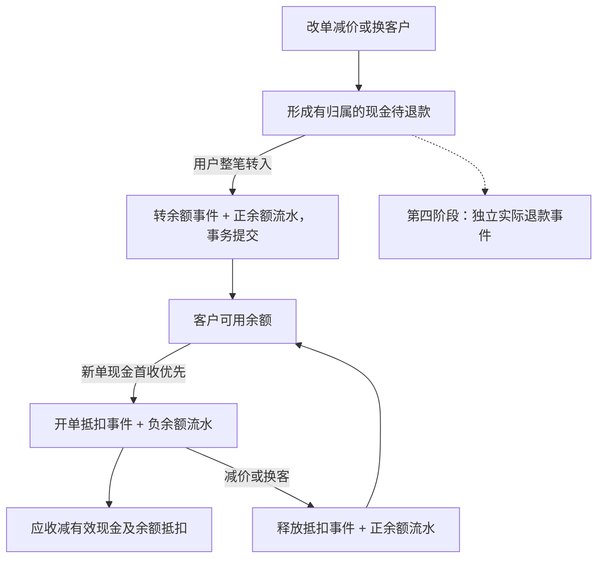
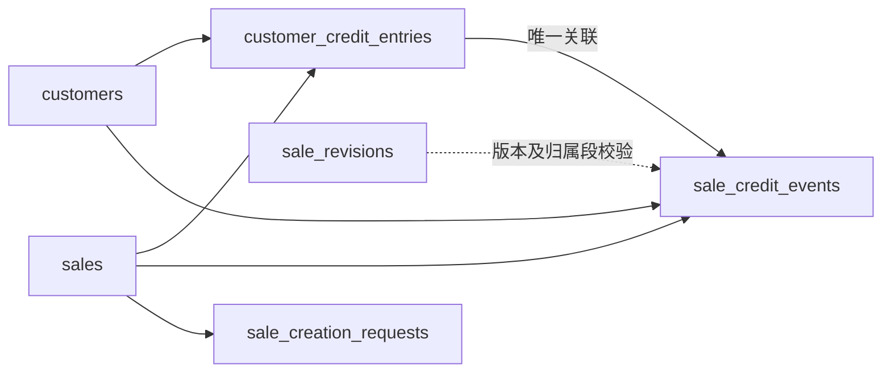

# 第三阶段：客户余额与收款闭环（2026-11-08）

本阶段完成代码、真实SQLite、Widget与跨模块自动化验证。当前数据库v9，候选应用版本0.1.2+3。正式版整体仍NO-GO：实际现金退款、完整退款日结/输出、客户商品编辑停用搜索及最终设备验收仍待完成。

## 已确认业务规则

用户确认本阶段按以下规则实施：

1. 新开单先计输入的现金首收，再用可用余额抵扣剩余应收，不足部分记欠款。
2. 同客户改单保留已有抵扣；减价时先释放超出新应收的抵扣。增加金额不自动追加抵扣，只形成新应收。
3. 换客户时抵扣全部释放到原客户可用余额，原现金仍按第二阶段的收款归属形成待退款；新客户不在改单时自动抵扣其余额。
4. 支持将当前整笔待退款手动转入其所属客户余额；不自动转入，不支持部分转入、无来源调账或任意撤销流水。部分退款/转入组合留给第四阶段处理。

复用了原`SaleSettlement`纯计算，并按这些明确规则修正早期原型“换客把现金自动转余额、自动抵扣新客户”的假设。对应领域测试因用户规则确认而调整；实现是否正确另由真实SQLite和UI链路验证，而非仅修改预期。

## 金额及状态关系

```text
有效现金 = 当前客户收款归属段的实际累计收款 - 该归属段已转余额金额
有效结算 = 有效现金 + 当前保留的余额抵扣
本单未收 = max(当前合同金额 - 有效结算, 0)
当前客户现金待退款 = max(有效现金 - 当前合同金额, 0)
旧客户现金待退款 = 旧归属段实际收款 - 该归属段已转余额金额
可用余额 = 全部余额流水delta_cents之和
```

余额与客户欠款分开显示，不自动净额抵销所有旧欠款。现金实际收款记录始终保留原金额；转余额不是现金支出，抵扣不是再次收到现金，释放不是新增现金。资金日结仍统计实际现金收支，因此转入/抵扣/释放不改已冻结的现金日结。



转入后再增价不会追回已转余额；该单形成新应收，余额留在客户账户。再次减价只对尚未返还的有效现金生成新的待退款。同一客户A→B→A仍保持各收款归属段独立。

## 界面与代码

- 客户列表显示欠款和可用余额；点击客户或销售详情的“查看客户余额与明细”可查看流水、来源单号、原因与逐笔结余。查询使用同一事务，页面没有改数入口。
- 销售详情对每个待退款归属提供“转入××余额”，确认后刷新该单、待退款和余额；失败后不把旧数字当成功。
- 新单编辑器展示可用余额、预计抵扣和预计未收，保存时按事务内真实可用余额计算。UI使用带持久请求键的开单接口，重复提交同内容返回原单。
- 改单确认展示释放金额，提交时在版本事务内释放；历史版本保留当时的抵扣和已转金额，不回写。
- `CustomerCreditLedger`继续承担v7追加流水及非负余额约束；`SaleCreditLedger`连接流水与业务事件，`AppDatabase`完成开单/转入，`SaleRevisionRepository`完成修改释放。
- PDF/图片显示现金已收、已转余额、余额抵扣和未收，CSV v3增加抵扣、转入与有效现金字段。跨客户完整退款凭证及实际退款输出仍属后续阶段。

## v9追加迁移与备份

| 表 | 作用 |
|---|---|
| `sale_credit_events` | 每条余额流水唯一关联业务来源；记录销售单、客户、收款归属段、销售版本、类型、金额、请求及时间。类型为transfer/apply/release/legacy |
| `sale_creation_requests` | 每单唯一开单请求，记录规范化输入；相同请求同内容返回原单，不同内容拒绝 |



不修改v1–v8既有迁移或余额金额。迁移只追加两张表，并将既有余额流水标为legacy，不猜测旧流水的现金来源或抵扣分配。旧客户余额和负流水原样保留；不会凭旧流水擅自减少历史应收。

新版本快照增加`creditCutoff`、`creditAppliedCents`、`transferredCents`，保存当时余额状态。v8及更早快照不补写原历史JSON。备份支持v2–v9，旧备份导入时创建legacy来源，新备份保留全部事件及幂等请求。恢复前同时验证流水、业务来源、抵扣容量、释放归属、整笔转入上限、历史资金守恒和请求内容；恢复仍仅允许全空数据库。

## 测试矩阵

| 编号 | 场景/前置 | 操作与预期 | 实际与数据库证据 | 状态 |
|---|---|---|---|---|
| C01 | 现金20000分，改单合同10000分 | 4次并发同键转入，只转10000分；错客户、部分金额、过期版本及不同键重复转入拒绝 | 余额10000、待退款清零，原收款20000/已转10000分别保留，现金日报仍20000；备份校验通过 | PASS |
| C02 | 可用余额10000分，合同8000/首收2000 | 自动抵扣6000，余款0，余额4000 | 销售、客户欠款、余额、实际现金日报逐项断言 | PASS |
| C03 | 可用10000，合同20000/首收2000 | 抵扣10000、未收8000；超收拒绝，补收8000后未收0 | 余额不透支，现金收款与余额不重复 | PASS |
| C04 | 可用10000，合同10000/首收10000 | 不消耗余额 | 抵扣0、余额10000、现金事实保留 | PASS |
| C05 | 余额10000 | 同键并发开单4次只建一单/抵扣一次；余下4000供两单并发申请 | 两单合计仅抵扣4000，欠款合计12000，可用余额0 | PASS |
| C06 | 合同10000、现金2000、抵扣8000 | 改至6000释放4000；再增至9000不追加；再换B全部释放 | 余额依次2000→6000→6000→10000；B重新应收9000，A现金待退2000；历史保留原抵扣 | PASS |
| C07 | 现金超收已转余额 | 再增价形成新应收，收款后再减价、再次转余额 | 不追回已转余额、不重复抵扣；最终有效现金及余额来源守恒 | PASS |
| C08 | 合同10000/现金2000/抵扣8000 | 降至1000 | 释放8000后只产生现金待退款1000，转入后余额11000，单据未收0 | PASS |
| C09 | 转入/抵扣/释放各自中途故障 | 触发器中断，恢复后重试 | 每次全表快照不变，无半笔流水/订单/版本；抵扣失败不清草稿 | PASS |
| C10 | 余额全链及部分释放 | 加密备份→独立空库恢复→关闭重开 | 所有业务表逐表一致，余额6000、抵扣4000、欠款0；篡改金额/归属/关联及删除来源拒绝 | PASS |
| C11 | 已有余额并输入超范围金额 | 拒绝开单且不扣余额 | 全表快照不变；开单沿用改单同等整数安全边界 | PASS |
| C12 | 跨午夜补收款 | 关账检查与写入使用同一次取时 | 只调用时钟一次，款项归11月8日而不是被第二次取时移到11月9日 | PASS |
| I01 | 入库→v1实际出库10000毫米→改单6000 | 生成待退4000毫米、现金待退14000分；日结后转余额，新单抵扣14000，次日补1000 | 转余额不动库存/不改旧日结；实际退货才加4000000微平方米；旧日报20000、新日报1000，余额与欠款0，快照可回放 | PASS |
| U01 | 真实SQLite余额及流水夹具 | 客户列表→余额页→刷新 | 页面余额80→50元，逐笔余额和来源单号与DB一致；夹具不冒充实际退款流程 | PASS |
| U02 | 真实待退款100元 | UI转入中断→提示重查/全表不变→重试转入→新单100元首收20元→抵扣80元→改单60元释放40元 | UI、DB及历史快照一致；故障不丢待办、不半入账，余额100→20→60元，新版抵扣40元，旧版80元 | PASS |
| M01 | 重建v8库含历史修订、收款及旧余额500分 | 升v9、恢复v8逻辑备份、继续真实转入/抵扣 | 原销售/收款/历史JSON逐表不变，旧余额标legacy；新业务后余额2500分且备份校验通过 | PASS |
| M02 | v9第二张表建表冲突 | 迁移中断 | user_version仍8、原销售/收款/版本/余额500保留、新事件表回滚、完整性正常 | PASS |
| A01 | 当前工作树完整回归 | 所有新旧模块参加 | 126项通过，静态检查无问题；日志见release-evidence/phase3-regression-20261108.log及phase3-analyze-20261108.log | PASS |
| O01 | U02保存后的实际Sale对象 | 生成CSV/PDF/PNG | CSV逐字段核对合同60、现金20、抵扣40、未收0及版本1；PDF文件头有效并保存实际产物 | PASS（生成/字段） |
| D01 | Android Release真机输入、转入、抵扣、进程强杀重启、打印、升级、离机恢复 | 本轮未执行 | 无真机业务证据；触发器和文件重开不等于设备中断 | NOT RUN |
| F01 | 实际现金退款与转余额并发、部分退款/部分转入 | 第四阶段实现后执行 | 目前无实际退款接口，不能标记防重复退款完整通过 | BLOCKED |

测试代码：`customer_credit_account_test.dart`、`customer_credit_widget_test.dart`、`customer_credit_flow_widget_test.dart`、`customer_credit_integration_test.dart`、`customer_credit_migration_test.dart`。既有第二阶段及采购、库存、资金日结、备份、输出等全部参加回归。

Release构建与签名校验PASS。候选包为`build/app/outputs/flutter-apk/app-release.apk`，另存`build/release-candidates/phase3-0.1.2+3.apk`（58.1MB）。包名`com.kaibao.kaibao_sales`、版本0.1.2+3、minSDK24。APK SHA-256为`2a844c937f884ea876a0bc4872487d304d642066b2de12259e35ebe78b76cc97`；证书SHA-256为`d5e48b89c69c2a9f10ad3944eaf8d87dce3dac40ee7c82e4528af9c42e7599ae`，与第二阶段一致，未执行安装或升级。

迁移库为隔离重建夹具，不是历史手机数据库副本；实际文件样例在被Git忽略的`build/phase3-output-evidence/`。PDF/PNG使用测试引擎生成，仅验证生成能力，未据此证明Android中文排版或物理打印正确。产物和缓存不进入Git。

## 未完成及发布限制

实际现金退款登记、防超退、退款渠道日结和退款与转余额的并发互斥需要第四阶段实现。本阶段已证明同笔待退款不能重复转余额、转入后从待退款剔除，但不能替不存在的实际退款API宣称验收通过。

客户商品编辑/停用/搜索、完整退款打印、目标真机业务链、物理打印、离机恢复和同标识同签名升级仍未完成。第三阶段代码与本机验证完成不等于正式版可发布。
